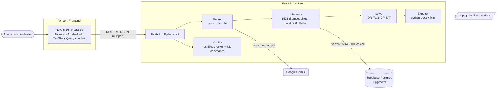

<div align="center">


# MedSchedule AI

**Integrated MBBS & BDS timetables, solved in minutes.**

Turn a medical or dental module syllabus into a conflict-free, horizontally and vertically integrated weekly timetable, then refine it on a drag-and-drop grid and export a print-ready, single-page Word document.

[**Live demo →**](https://medschedule-ai.vercel.app/)

[](https://github.com/dawoodcs195-spec/medschedule-ai/actions/workflows/ci.yml)
[](LICENSE)
[](https://medschedule-ai.vercel.app/)


<br />

<a href="https://medschedule-ai.vercel.app/"></a>

</div>

---

## Table of contents

- [Why it exists](#why-it-exists)
- [Features](#features)
- [Screenshots](#screenshots)
- [Architecture](#architecture)
- [Tech stack](#tech-stack)
- [How scheduling and integration work](#how-scheduling-and-integration-work)
- [Project structure](#project-structure)
- [Getting started](#getting-started)
- [Environment variables](#environment-variables)
- [Deployment](#deployment)
- [Roadmap](#roadmap)
- [Author](#author)
- [License](#license)

## Why it exists

Integrated modular curricula ask coordinators to line up basic sciences (Anatomy, Physiology, Histology, Biochemistry) in the same week as each other — **horizontal integration** — and to tie them to clinical specialties (Surgery, Medicine, ENT, Ophthalmology, Paediatrics, Radiology) — **vertical integration**. On top of that, every practical block must rotate four student batches through four labs at once, Fridays end at noon, and the final timetable has to fit on one landscape page. That is usually done by hand in Word or Excel.

MedSchedule AI automates the whole loop: **Upload → Align → Generate → Refine → Export.**

## Features

- **Multi-format curriculum ingestion** — upload `.docx`, `.xlsx` or `.txt` (a syllabus or last year's timetable), or paste lines in `Subject | Format | Topic | Faculty` form. A fast rule-based parser handles structured files; unstructured prose is sent to Gemini for JSON-schema-constrained extraction of topics, disciplines, session formats and faculty.
- **Integration review screen** — proposed horizontal and vertical links with similarity scores and rationales; filter, edit, approve, delete, add your own, or auto-suggest missing clinical correlation topics before solving.
- **Constraint-based solver** — Google OR-Tools **CP-SAT** builds a 6-day week (08:00–14:00, 12:00–12:30 break, Friday half-day until 12:00) with simultaneous 4-batch (A–D) rotations across Histology, Physiology, Biochemistry and Skill Lab.
- **Interactive matrix grid** — drag-and-drop rescheduling with *soft* conflict warnings (clashes are highlighted with suggested open slots instead of being blocked), undo/redo, and side-by-side comparison with the uploaded legacy timetable.
- **Scheduling copilot** — natural-language commands such as *"swap Monday 8 AM with Wednesday 9 AM"*, *"reassign … to Dr. …"* or *"remove …"*, each validated against the same conflict checker.
- **Analytics** — contact hours per subject, time-slot distribution and faculty workload.
- **One-page Word export** — A4 landscape `.docx` generated with `python-docx` + raw OpenXML (`gridSpan` merges, fixed DXA column widths, discipline shading) with practical/SGD legend keys appended automatically.
- **Polished UX** — medical-teal design system, animated landing page, a 9-step first-run product tour, light/dark themes and responsive layouts down to mobile.
- **Runs without infrastructure** — no database or API key is required to try it: the backend falls back to in-memory storage, in-process cosine similarity and the rule-based parser.

## Screenshots

| Light | Dark |
| :---: | :---: |
|  |  |
|  |  |
|  |  |
|  |  |

<details>
<summary><b>First-run tour and mobile</b></summary>
<br />


<p>

&nbsp;&nbsp;

</p>

</details>

## Architecture



Both external services are optional: without `GEMINI_API_KEY` the rule-based parser is used, and without a reachable database the integrator computes cosine similarity in memory.

## Tech stack

| Layer | Technology |
| :--- | :--- |
| Frontend | Next.js 16 (App Router), React 19, TypeScript 5, Tailwind CSS v4, shadcn/ui (Base UI), `motion`, `@dnd-kit/core`, TanStack Query, lucide-react |
| Backend | Python 3.12, FastAPI, Pydantic v2 / pydantic-settings, Uvicorn |
| AI | Google Gemini via `google-genai` (default `gemini-2.5-flash`) for structured extraction of unstructured syllabi |
| Optimisation | Google OR-Tools CP-SAT |
| Data | Supabase PostgreSQL 16 + `pgvector` (HNSW cosine index), SQLAlchemy 2, psycopg2 |
| Documents | `python-docx`, `lxml`, `openpyxl` |
| Tooling & CI | ESLint 9, GitHub Actions |
| Hosting | Vercel (frontend and FastAPI as a Python function); Render Blueprint and Dockerfile included |

## How scheduling and integration work

1. **Ingestion.** `parser.py` reads the upload (`python-docx`, `openpyxl` or plain text) and first runs a fast rule-based extractor that recognises module headers, legend keys, timetable cells and `Subject | Format | Topic | Faculty` lines. Only when that finds nothing (free-form prose) does it call Gemini for a JSON-schema-constrained extraction, with a 12 s timeout and graceful fallback. Both paths produce the same `ParsedTopic` models.
2. **Integration.** `integrator.py` turns every topic into a 1536-dimensional vector. Embeddings are currently computed locally with a deterministic hashing scheme enriched with medical concept clusters (e.g. spinal cord, cranial/radiology, synapse, special senses), so results are reproducible and work offline. When topics are persisted, pairs are ranked in Postgres with pgvector's `<=>` cosine distance; otherwise cosine similarity is computed in process. Pairs across basic sciences above a threshold become **horizontal** links; basic-science ↔ clinical pairs become **vertical** links. The coordinator reviews and approves them in the UI.
3. **Solving.** `solver.py` builds a CP-SAT model over a slot grid that already encodes the operating hours, the 12:00–12:30 break and the Friday half-day. Boolean variables assign each topic to exactly one slot (at most one topic per slot) and each batch to a lab in every practical block, with hard constraints that each lab hosts exactly one batch, each batch is in exactly one lab, and every batch visits all four stations once across the week (a Latin-square rotation). Approved integration links become an objective that maximises same-day co-scheduling of linked topics. The solver runs with a time limit (8 s by default).
4. **Refinement.** Every drag-and-drop or copilot command goes through `copilot.py`'s conflict checker, which flags clashes (slot, venue, faculty, Friday half-day, daily break) as soft warnings and proposes open alternative slots.
5. **Export.** `exporter.py` writes one A4-landscape page per week with fixed column widths, merged multi-hour cells and an automatic legend.

## Project structure

```text
medschedule-ai/
├── frontend/                       # Next.js app (deployed to Vercel)
│   ├── public/og.png               # Open Graph / social preview image
│   └── src/
│       ├── app/                    # layout, page, global design tokens, icon
│       ├── components/
│       │   ├── landing/            # animated landing page & hero visual
│       │   ├── tour/               # 9-step first-run product tour
│       │   ├── workspace/          # upload step, header, solver overlay
│       │   ├── integration/        # integration review & approval
│       │   ├── grid/               # timetable matrix with drag-and-drop
│       │   ├── copilot/            # copilot / inspector drawer
│       │   ├── analytics/          # workload analytics dashboard
│       │   └── ui/                 # shadcn/ui primitives
│       ├── lib/                    # API client, theme, hooks, utils
│       └── types/                  # shared TypeScript types
├── backend/                        # FastAPI service
│   ├── app/
│   │   ├── api/routes.py           # REST endpoints (/api/...)
│   │   ├── core/                   # settings, DB engine, Gemini client, constants
│   │   ├── models/                 # SQLAlchemy models & Pydantic schemas
│   │   └── services/               # parser, integrator, solver, copilot, exporter
│   ├── tests/smoke_full_pipeline.py
│   ├── requirements.txt
│   ├── vercel.json · Dockerfile · Procfile
├── supabase/migrations/            # PostgreSQL + pgvector schema
├── docs/                           # PRD, architecture plan, sample timetable, screenshots
├── .github/workflows/ci.yml        # lint, build and backend smoke test
├── render.yaml                     # Render Blueprint for the backend
└── AGENTS.md                       # domain rules & constraints for contributors/agents
```

## Getting started

**Prerequisites:** Node.js ≥ 20.9, Python 3.12, and optionally a Gemini API key and a Postgres database with `pgvector`.

```bash
git clone https://github.com/dawoodcs195-spec/medschedule-ai.git
cd medschedule-ai
```

### 1. Backend — FastAPI on port 8000

```bash
cd backend
python -m venv .venv && source .venv/bin/activate   # Windows: .venv\Scripts\activate
pip install -r requirements.txt
cp .env.example .env                                 # optional: add GEMINI_API_KEY / DATABASE_URL
uvicorn app.main:app --reload --port 8000
```

Interactive API docs: <http://localhost:8000/docs>. Health check: <http://localhost:8000/api/health>.

### 2. Frontend — Next.js on port 3000

```bash
cd frontend
cp .env.example .env.local
npm install
npm run dev
```

Open <http://localhost:3000>.

### 3. Database (optional)

Create a Supabase project (or any Postgres 16 with `pgvector`) and run `supabase/migrations/001_initial_schema.sql`, then set `DATABASE_URL` in `backend/.env`.

### Checks

```bash
cd frontend && npm run lint && npm run build
cd backend  && python -m compileall -q app && python tests/smoke_full_pipeline.py
```

The smoke test runs the full pipeline offline (ingest sample `.docx` → integrate → solve → validate a move → export).

## Environment variables

**Backend** (`backend/.env`, see [`backend/.env.example`](backend/.env.example))

| Variable | Required | Description |
| :--- | :---: | :--- |
| `GEMINI_API_KEY` | No | Enables Gemini extraction for unstructured input; the rule-based parser works without it. |
| `GEMINI_MODEL` | No | Gemini model id. Default `gemini-2.5-flash`. |
| `GEMINI_EMBEDDING_MODEL` | No | Read by config; reserved for a hosted embedding model. |
| `DATABASE_URL` | No | Postgres connection string (pgvector). Falls back to `SUPABASE_URL`, then localhost. |
| `SUPABASE_URL` | No | Supabase Postgres connection string. |
| `SUPABASE_KEY` | No | Supabase key (reserved). |
| `CORS_ORIGINS` | No | Comma-separated allowed origins, or `*`. `*.vercel.app` previews are always allowed. |
| `OPENBLAS_NUM_THREADS` | No | Defaults to `1` to keep small instances responsive. |

**Frontend** (`frontend/.env.local`, see [`frontend/.env.example`](frontend/.env.example))

| Variable | Required | Description |
| :--- | :---: | :--- |
| `NEXT_PUBLIC_API_URL` | No | Backend base URL including `/api`. Defaults to `https://medschedule-ai-api.vercel.app/api` in production and `http://localhost:8000/api` in development. |

## Deployment

- **Frontend (Vercel).** Import the repo, set **Root Directory** to `frontend`, framework preset **Next.js**, and set `NEXT_PUBLIC_API_URL`. Pushes to `main` deploy to production; pull requests get preview deployments. Live at <https://medschedule-ai.vercel.app/>.
- **Backend (Vercel).** A second Vercel project with Root Directory `backend` uses `backend/vercel.json` (`@vercel/python`) to serve `app/main.py`.
- **Backend (container hosts).** `render.yaml` is a ready Render Blueprint (`uvicorn app.main:app --host 0.0.0.0 --port $PORT`); a `Dockerfile` and `Procfile` are included for Railway, Fly.io and similar.

## Roadmap

- [ ] Use a hosted embedding model (Gemini) behind the existing `GEMINI_EMBEDDING_MODEL` setting, with the local embeddings kept as fallback
- [ ] LLM-backed copilot for open-ended requests, keeping the current validated command handlers
- [ ] Multi-week module planning and cross-week balancing
- [ ] Authentication and multi-institution workspaces (Supabase Auth)
- [ ] Persist saved schedules in Postgres instead of a local JSON file
- [ ] Unit tests for solver constraints and the exporter; Playwright UI tests
- [ ] PDF export alongside `.docx`

## Author

**Muhammad Dawood**
GitHub: [@dawoodcs195-spec](https://github.com/dawoodcs195-spec)

If this project is useful to you, a ⭐ on the repo is appreciated.

## License

Released under the [MIT License](LICENSE). © 2026 Muhammad Dawood.
