<div align="center">


# MedSchedule AI

**Integrated MBBS & BDS timetables, solved in minutes.**

Turn a medical or dental module syllabus into a conflict-free, horizontally and vertically integrated weekly timetable, then refine it on a drag-and-drop grid and export a print-ready, single-page Word document.

[**Live demo →**](https://medschedule-ai.vercel.app/) &nbsp;·&nbsp; [API docs](https://medschedule-ai-api.vercel.app/docs)

[](https://github.com/dawoodcs195-spec/medschedule-ai/actions/workflows/ci.yml)
[](LICENSE)
[](https://medschedule-ai.vercel.app/)


<br />

<a href="https://medschedule-ai.vercel.app/">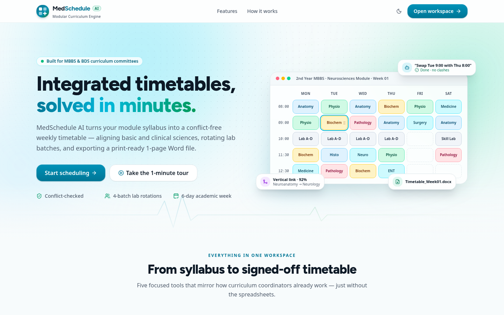</a>

</div>

---

## Table of contents

- [Why it exists](#why-it-exists)
- [Features](#features)
- [Screenshots](#screenshots)
- [Architecture](#architecture)
- [Tech stack](#tech-stack)
- [How scheduling and integration work](#how-scheduling-and-integration-work)
- [Project structure](#project-structure)
- [Getting started](#getting-started)
- [Environment variables](#environment-variables)
- [API overview](#api-overview)
- [Deployment](#deployment)
- [Roadmap](#roadmap)
- [Author](#author)
- [License](#license)

## Why it exists

Integrated modular curricula ask coordinators to line up basic sciences (Anatomy, Physiology, Histology, Biochemistry) in the same week as each other — **horizontal integration** — and to tie them to clinical specialties (Surgery, Medicine, ENT, Ophthalmology, Paediatrics, Radiology) — **vertical integration**. On top of that, every practical block must rotate four student batches through four labs at once, Fridays end at noon, and the final timetable has to fit on one landscape page. That is usually done by hand in Word or Excel.

MedSchedule AI automates the whole loop: **Upload → Align → Generate → Refine → Export.**

## Features

- **Multi-format, multi-class ingestion** — upload `.docx`, `.xlsx` or `.txt` timetables for one class or all of them at once (MBBS 1st–Final, BDS 1st–Final), or paste lines in `Subject | Format | Topic | Faculty` form. Each file's class comes from its `TIMETABLE FOR 2ND YEAR MBBS` header (or its file name), several classes can sit in one file, and topics taught more than once are counted. A fast rule-based parser handles structured files; unstructured prose is sent to Gemini for JSON-schema-constrained extraction.
- **Semantic topic matching that works offline** — a medical/dental ontology (organs, systems, diseases; *cardiac → heart*, *renal → kidney*, *diabetic → diabetes*) combined with TF-IDF and character n-grams links *"Heart chambers"* (Anatomy) with *"Cardiac cycle"* (Physiology), or *"Diabetic retinopathy"* (Eye) with *"Diabetes mellitus"* (Medicine) and *"Diabetic foot"* (Surgery). Same class → **horizontal** link; different year → **vertical** link. Gemini embeddings can be blended in with `EMBEDDING_PROVIDER=gemini`.
- **Integration review screen** — proposed links with scores, shared concepts and rationales, filterable by class; approve, reject, add your own, or auto-suggest missing clinical correlation topics before solving.
- **Integrated, constraint-based solver** — Google OR-Tools **CP-SAT** builds a 6-day week (08:00–14:00, 12:00–12:30 break, Friday half-day until 12:00) with simultaneous 4-batch (A–D) lab rotations. Linked topics are packed into the same week and placed on the same or adjacent days in teaching order (anatomy → histology → physiology → biochemistry → pathology → medicine → surgery/specialties), and a teacher shared between classes is never double-booked when avoidable.
- **Interactive matrix grid** — drag-and-drop rescheduling with *soft* conflict warnings (clashes are highlighted with suggested open slots instead of being blocked), undo/redo, and side-by-side comparison with the uploaded legacy timetable.
- **Scheduling copilot** — natural-language commands such as *"Give Cardiac cycle to Dr. Tariq"*, *"Renal filtration with Dr. Asma"*, *"Replace Dr. A with Dr. B"*, *"Swap Monday 8 AM with Wednesday 9 AM"* or *"Move … to Friday 10"* — or a numbered list of changes applied in one go — each validated against the same conflict checker.
- **Analytics & report** — per week: contact hours, classes per subject and per teacher, time-slot distribution and how well linked topics were co-located; for the whole upload: classes per subject, how many times each topic is covered and teacher load across all classes, downloadable as a `.docx` report.
- **One-page Word export** — A4 landscape `.docx` per class and week, generated with `python-docx` + raw OpenXML (`gridSpan` merges, fixed DXA column widths, discipline shading) with practical/SGD legend keys appended automatically.
- **Polished UX** — medical-teal design system, animated landing page, a 9-step first-run product tour, light/dark themes and responsive layouts down to mobile.
- **Runs without infrastructure** — no database or API key is required to try it: the backend falls back to in-memory storage, in-process cosine similarity and the rule-based parser.

## Screenshots

| Light | Dark |
| :---: | :---: |
|  | 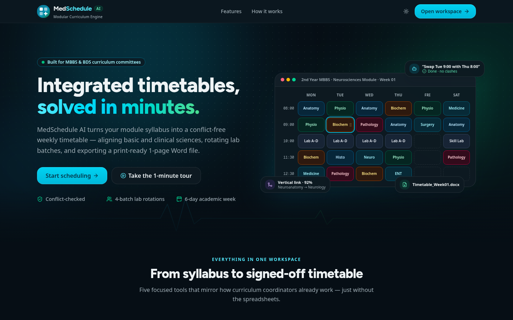 |
| 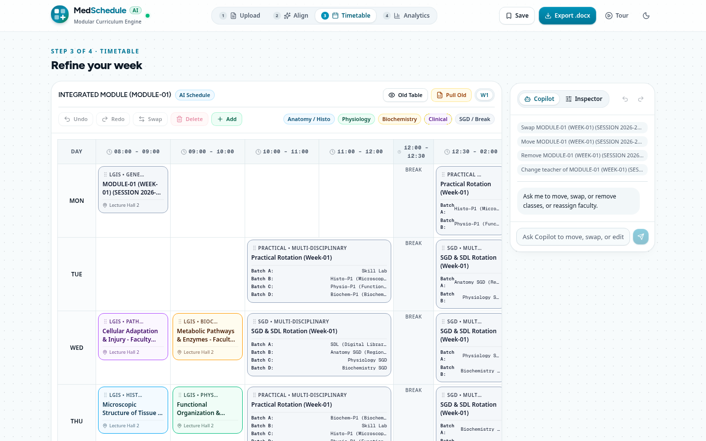 | 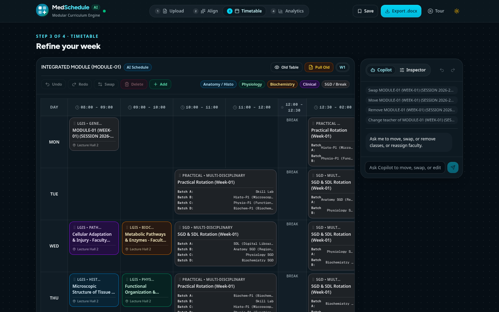 |
| 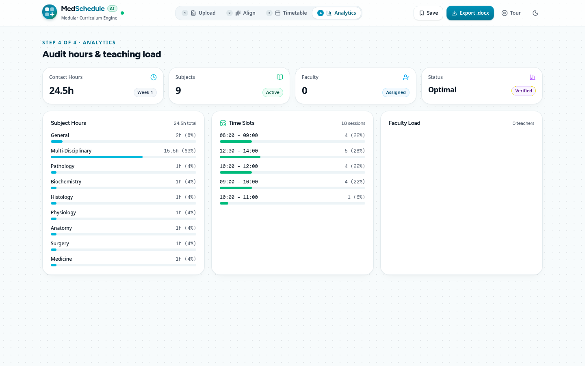 | 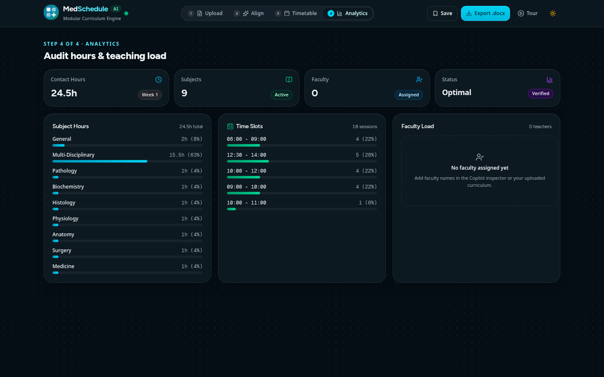 |
| 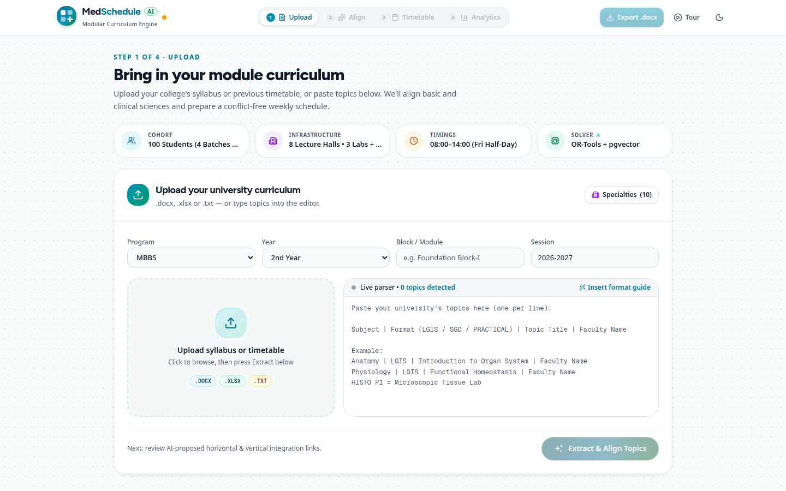 | 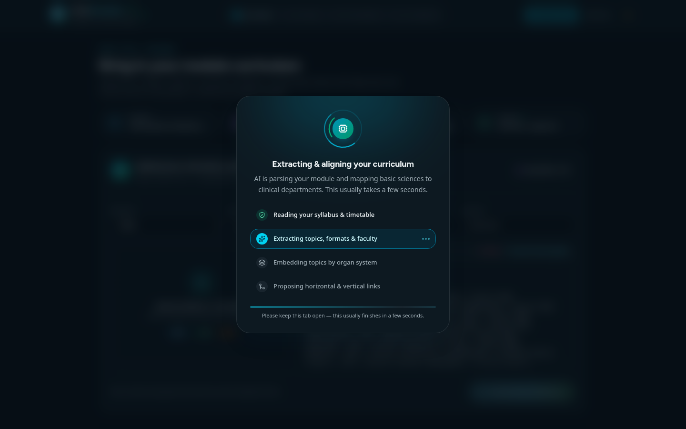 |

<details>
<summary><b>First-run tour and mobile</b></summary>
<br />

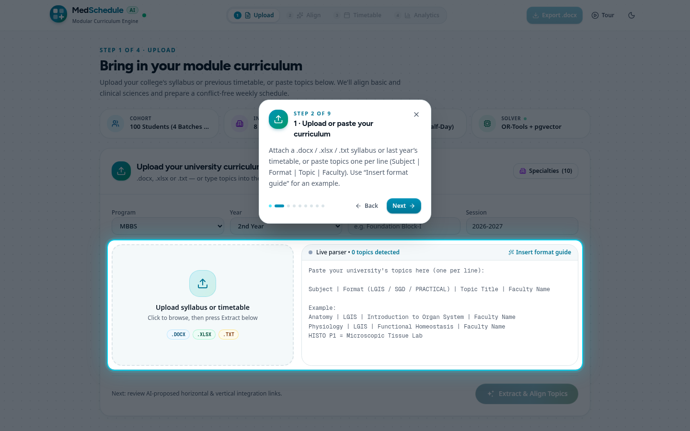

<p>
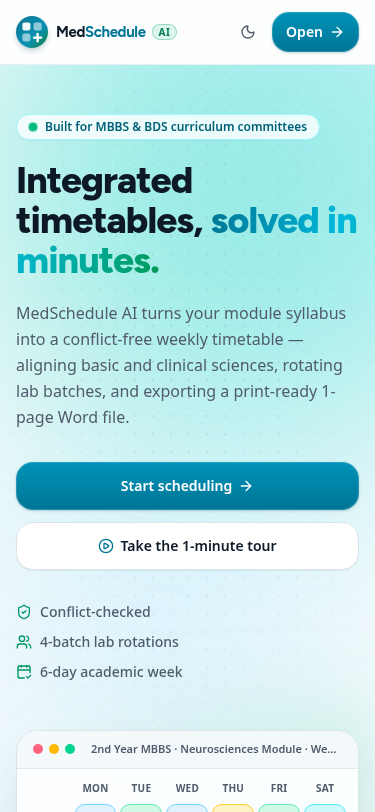
&nbsp;&nbsp;
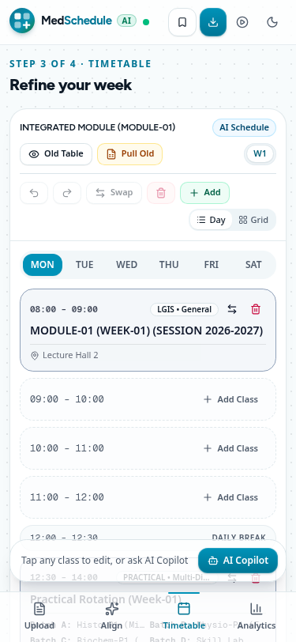
</p>

</details>

## Architecture

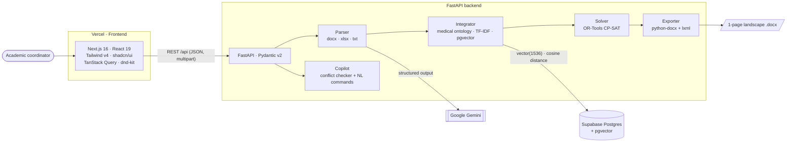

Both external services are optional: without `GEMINI_API_KEY` the rule-based parser is used, and without a reachable database the integrator computes cosine similarity in memory.

## Tech stack

| Layer | Technology |
| :--- | :--- |
| Frontend | Next.js 16 (App Router), React 19, TypeScript 5, Tailwind CSS v4, shadcn/ui (Base UI), `motion`, `@dnd-kit/core`, TanStack Query, lucide-react |
| Backend | Python 3.12, FastAPI, Pydantic v2 / pydantic-settings, Uvicorn |
| AI | Google Gemini via `google-genai` (default `gemini-2.5-flash`) for structured extraction of unstructured syllabi |
| Optimisation | Google OR-Tools CP-SAT |
| Data | Supabase PostgreSQL 16 + `pgvector` (HNSW cosine index), SQLAlchemy 2, psycopg2 |
| Documents | `python-docx`, `lxml`, `openpyxl` |
| Tooling & CI | ESLint 9, GitHub Actions (frontend lint + build; backend compile, import check, smoke and test suites) |
| Hosting | Vercel (frontend and FastAPI as a Python function); Render Blueprint and Dockerfile included |

## How scheduling and integration work

1. **Ingestion.** `parser.py` reads the upload (`python-docx`, `openpyxl` or plain text) and first runs a fast rule-based extractor that recognises module headers, legend keys, timetable cells and `Subject | Format | Topic | Faculty` lines. Only when that finds nothing (free-form prose) does it call Gemini for a JSON-schema-constrained extraction, with a 12 s timeout and graceful fallback. Both paths produce the same `ParsedTopic` models.
2. **Integration.** `semantic.py` normalises each topic (British spellings, plurals, adjective forms such as *cardiac → heart*), maps it to concepts in a compact medical/dental ontology (organs, diseases, systems) and scores pairs as 0.55 × shared concepts + 0.15 × shared organ system + 0.30 × lexical similarity (TF-IDF over words and character 4-grams). `integrator.py` keeps pairs above 0.45, classifies them by class — same class, different subjects → **horizontal**; different years → **vertical** — and keeps each topic's strongest partners. Everything runs offline in pure Python (≈20 ms for 60 topics, ≈1 s for 600); `EMBEDDING_PROVIDER=gemini` optionally blends in Gemini embeddings. Persisted topics also get a 1536-d feature-hashed vector for pgvector's `<=>` queries. The coordinator reviews and approves links in the UI.
3. **Solving.** `solver.py` first plans the module: approved links are grouped (union-find), each group is ordered structure → function → disease → management and packed whole into one teaching week. CP-SAT then places the week over a slot grid that already encodes the operating hours, the 12:00–12:30 break and the Friday half-day, minimising the day gap between linked lectures and penalising any linked pair taught out of order (warm-started from the planned order). Lab rotations keep their hard constraints: each lab hosts exactly one batch, each batch is in exactly one lab, and every batch visits all four stations once a week (a Latin square). For multi-class uploads `/schedule/generate-all` solves classes busiest-first and penalises any slot where a teacher is already teaching another class. Each lecture cell carries its links (*"↔ Physiology: Cardiac cycle (Tue 09:00)"*, *"↕ 4th Year MBBS Medicine: Diabetes mellitus"*).
4. **Refinement.** Every drag-and-drop or copilot command goes through `copilot.py`'s conflict checker, which flags clashes (slot, venue, faculty, Friday half-day, daily break) as soft warnings and proposes open alternative slots.
5. **Export.** `exporter.py` writes one A4-landscape page per week with fixed column widths, merged multi-hour cells and an automatic legend.

## Project structure

```text
medschedule-ai/
├── frontend/                       # Next.js app (deployed to Vercel)
│   ├── public/og.png               # Open Graph / social preview image
│   └── src/
│       ├── app/                    # layout, page, global design tokens, icon
│       ├── components/
│       │   ├── landing/            # animated landing page & hero visual
│       │   ├── tour/               # 9-step first-run product tour
│       │   ├── workspace/          # upload step, header, solver overlay
│       │   ├── integration/        # integration review & approval
│       │   ├── grid/               # timetable matrix with drag-and-drop
│       │   ├── copilot/            # copilot / inspector drawer
│       │   ├── analytics/          # workload analytics dashboard
│       │   └── ui/                 # shadcn/ui primitives
│       ├── lib/                    # API client, theme, hooks, utils
│       └── types/                  # shared TypeScript types
├── backend/                        # FastAPI service
│   ├── app/
│   │   ├── api/routes.py           # REST endpoints (/api/...)
│   │   ├── core/                   # settings, DB engine, Gemini client, constants
│   │   ├── models/                 # SQLAlchemy models & Pydantic schemas
│   │   └── services/               # parser, integrator, solver, copilot, exporter
│   ├── tests/                      # smoke pipeline + client, upload-field and real-timetable tests, fixtures
│   ├── requirements.txt
│   ├── vercel.json · Dockerfile · Procfile
├── supabase/migrations/            # PostgreSQL + pgvector schema
├── docs/                           # PRD, architecture plan, sample timetable, screenshots
├── .github/workflows/ci.yml        # frontend lint/build, backend compile, smoke + test suites
├── render.yaml                     # Render Blueprint for the backend
└── AGENTS.md                       # domain rules & constraints for contributors/agents
```

## Getting started

**Prerequisites:** Node.js ≥ 20.9, Python 3.12, and optionally a Gemini API key and a Postgres database with `pgvector`.

```bash
git clone https://github.com/dawoodcs195-spec/medschedule-ai.git
cd medschedule-ai
```

### 1. Backend — FastAPI on port 8000

```bash
cd backend
python -m venv .venv && source .venv/bin/activate   # Windows: .venv\Scripts\activate
pip install -r requirements.txt
cp .env.example .env                                 # optional: add GEMINI_API_KEY / DATABASE_URL
uvicorn app.main:app --reload --port 8000
```

Interactive API docs: <http://localhost:8000/docs>. Health check: <http://localhost:8000/api/health>.

### 2. Frontend — Next.js on port 3000

```bash
cd frontend
cp .env.example .env.local
npm install
npm run dev
```

Open <http://localhost:3000>.

### 3. Database (optional)

Create a Supabase project (or any Postgres 16 with `pgvector`) and run `supabase/migrations/001_initial_schema.sql`, then set `DATABASE_URL` in `backend/.env`.

### Checks

```bash
cd frontend && npm run lint && npm run build
cd backend  && python -m compileall -q app \
  && python tests/smoke_full_pipeline.py \
  && python tests/test_client_requirements.py \
  && python tests/test_upload_fields.py \
  && python tests/test_real_timetable.py
```

The smoke test runs the full pipeline offline (ingest sample `.docx` → integrate → solve → validate a move → export). `test_client_requirements.py` uploads three classes at once (2nd Year MBBS `.docx`, 4th Year MBBS `.xlsx`, 1st Year BDS `.txt`, in `tests/fixtures/`) and checks the expected horizontal/vertical links and non-links, integrated ordering, teacher clashes, Copilot edits, report counts and exports. `test_upload_fields.py` covers the upload form (session, module override, detected class) and `test_real_timetable.py` runs the template scheduler on an anonymised real module (no clashes, fixed rotations, subject order, export). All of these run in CI on every push and pull request.

## Environment variables

**Backend** (`backend/.env`, see [`backend/.env.example`](backend/.env.example))

| Variable | Required | Description |
| :--- | :---: | :--- |
| `GEMINI_API_KEY` | No | Enables Gemini extraction for unstructured input; the rule-based parser works without it. |
| `GEMINI_MODEL` | No | Gemini model id. Default `gemini-2.5-flash`. |
| `EMBEDDING_PROVIDER` | No | `local` (default, offline ontology + TF-IDF) or `gemini` to blend Gemini embeddings into link scores. |
| `GEMINI_EMBEDDING_MODEL` | No | Embedding model used when `EMBEDDING_PROVIDER=gemini`. |
| `DATABASE_URL` | No | Postgres connection string (pgvector). Falls back to `SUPABASE_URL`, then localhost. |
| `SUPABASE_URL` | No | Supabase Postgres connection string. |
| `SUPABASE_KEY` | No | Supabase key (reserved). |
| `CORS_ORIGINS` | No | Comma-separated allowed origins, or `*`. `*.vercel.app` previews are always allowed. |
| `OPENBLAS_NUM_THREADS` | No | Defaults to `1` to keep small instances responsive. |

**Frontend** (`frontend/.env.local`, see [`frontend/.env.example`](frontend/.env.example))

| Variable | Required | Description |
| :--- | :---: | :--- |
| `NEXT_PUBLIC_API_URL` | No | Backend base URL including `/api`. Defaults to `https://medschedule-ai-api.vercel.app/api` in production and `http://localhost:8000/api` in development. |

## API overview

All routes are under `/api` (interactive docs at `/docs`).

| Area | Endpoints |
| :--- | :--- |
| System | `GET /health` |
| Ingestion | `POST /ingest/text` · `POST /ingest/file` · `POST /ingest/batch` |
| Reference | `GET/POST /departments` · `GET /reference/facilities` |
| Integration | `POST /integrate/cluster` · `GET/POST /integrations` · `PATCH/PUT/DELETE /integrations/{id}` · `POST /integrate/suggest-clinical` |
| Scheduling | `POST /schedule/generate` · `POST /schedule/generate-all` · `POST /schedule/original` · `POST /schedule/validate-move` · `POST /schedule/swap` · `POST /schedule/remove` · `POST /schedule/add-cell` · `POST /schedule/update-cell` |
| Saved schedules | `GET /schedules/saved` · `POST /schedules/save` · `DELETE /schedules/saved/{id}` |
| Copilot | `POST /copilot/chat` |
| Analytics | `POST /analytics/report` |
| Export | `POST /export/docx` · `POST /export/report-docx` |

## Deployment

- **Frontend (Vercel).** Import the repo, set **Root Directory** to `frontend`, framework preset **Next.js**, and set `NEXT_PUBLIC_API_URL`. Pushes to `main` deploy to production; pull requests get preview deployments. Live at <https://medschedule-ai.vercel.app/>.
- **Backend (Vercel).** A second Vercel project with Root Directory `backend` uses `backend/vercel.json` (`@vercel/python`) to serve `app/main.py`.
- **Backend (container hosts).** `render.yaml` is a ready Render Blueprint (`uvicorn app.main:app --host 0.0.0.0 --port $PORT`); a `Dockerfile` and `Procfile` are included for Railway, Fly.io and similar.

## Roadmap

- [ ] LLM-backed copilot for open-ended requests, keeping the current validated command handlers
- [ ] Share labs and lecture halls across classes (today each class's rotations are planned independently)
- [ ] Authentication and multi-institution workspaces (Supabase Auth)
- [ ] Persist saved schedules in Postgres instead of a local JSON file
- [ ] Move the test scripts to pytest with coverage reporting; Playwright UI tests
- [ ] PDF export alongside `.docx`

## Author

**Muhammad Dawood**, Full-Stack Developer

- Email: [dawood.cs195@gmail.com](mailto:dawood.cs195@gmail.com)
- GitHub: [@dawoodcs195-spec](https://github.com/dawoodcs195-spec)

If this project is useful to you, a ⭐ on the repo is appreciated.

## License

Released under the [MIT License](LICENSE). © 2026 Muhammad Dawood.
